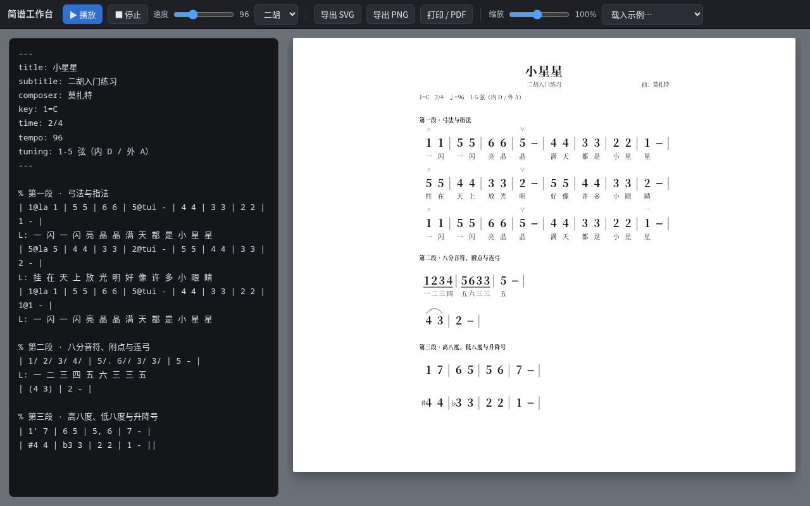

# jianpu-md · 文本简谱渲染器

**English:** Render Chinese numbered musical notation (jianpu) written as plain Markdown into print-ready SVG, with synthesised erhu playback. Ships as a web workbench, a CLI, and an Obsidian plugin.

用 Markdown / 纯文本写简谱，渲染成**打印级 SVG**，点一下就能用**二胡音色**放出来。

为学二胡的孩子做的。五线谱软件一大堆，简谱要么收费、要么不开源、要么不能播放；开源的那几个又要装 Python + LilyPond 两百多兆。这个只要一个现代浏览器。

```
| 1@la 1 | 5 5 | 6 6 | 5@tui - | 4 4 | 3 3 | 2 2 | 1 - |
L: 一 闪 一 闪 亮 晶 晶 满 天 都 是 小 星 星
```



## 特性

- **纯文本存储**：`.md` / `.txt`，能进 git、能 diff、手机记事本也能改
- **所见即所得改谱**：工作台里点住一个音——**左右拖 = 改时值，上下拖 = 改音级，Shift+上下 = 改八度**，边拖边看；按住 Shift 点选或框选多个音，可以一起改、一起加连弓。所有操作最终都只落到源码里的那几个字符上，不改变你的文件格式
- **可选纸张**：A3 / A4 / A5 / B5 / Letter × 竖版 / 横版，默认 A4 竖版；边距按幅面等比缩，字号和物理尺寸不变（小纸就是每行少放几个小节）
- **打印级排版**：输出 SVG 矢量，A4 自动分页，行内两端对齐，减时线按拍分组连横
- **吃 JPW-ABC**：`1_` 减时线、`(6.5)(45)6` 粘连连弓、`{DunYin}` 技法名、`|[1.` 一二房子、`$` 段落、`"渐慢"` 文字、行内换拍，都能直接粘进来（对照表与取舍见 [`docs/03`](docs/03-JPW-ABC-对照与兼容.md)）
- **显式小节号**：`// 35` 钉死下一小节编号，空小节不会被静默吞掉，号不会漂
- **二胡记号**：`@la` 拉弓、`@tui` 推弓、`@0`–`@4` 指法、`@tr` 打弦、`@chuo/@zhu` 绰注、`@rou` 揉弦、`@o` 泛音、`@nei/@wai` 内外弦
- **二胡音色播放**：Web Audio 手写合成器（锯齿波 + 揉弦颤音 + 低通 + 弓压包络），音符跟着高亮
- **零运行时依赖**：core 只用 TypeScript 编译产物，浏览器直接 `<script type="module">` 引，不需要打包器
- **能校验**：小节拍数不对、歌词对不齐、圆滑线没闭合，实时告警
- **能保存**：工作台直接写回 NAS 上的 `.md`（`Ctrl+S`），`examples/`、`scores/` 里的谱都能列出来打开；浏览器端另有自动草稿兜底，断电也不丢

## 快速开始

```bash
git clone <this-repo> jianpu && cd jianpu
npm install          # 只有一个 devDependency：typescript
npm run build        # src/*.ts → dist/*.js
npm run serve        # 静态服务器（tools/serve.py，带 no-store，改完刷新即可）
# 打开 http://127.0.0.1:8080/web/
```

命令行出图：

```bash
node bin/jianpu.mjs examples/小星星.md -o 小星星          # → 小星星.svg
node bin/jianpu.mjs examples/小星星.md --html -o out      # → out/*.svg + out/preview.html
node bin/jianpu.mjs examples/小星星.md --check            # 只做校验
```

## 语法

元信息放 front matter，乐谱一行一行写，`|` 是小节线，`L:` 是歌词。

```markdown
---
title: 小星星
composer: 莫扎特
key: 1=C          # 1=C / 1=F / 6=F#（小调写 6=）
time: 2/4
tempo: 96
tuning: 1-5 弦（内 D / 外 A）
---

% 段落标题
| 1 2 | 3 4 |
L: 一 二 三 四
```

### 音符

| 写法 | 含义 |
|---|---|
| `1`–`7` | 唱名，四分音符 |
| `0` / `x` | 休止 / 噪音（打击） |
| `1'` `1''` | 高八度、高两个八度 |
| `1,` `1,,` | 低八度、低两个八度 |
| `#4` `b3` `n5` | 升、降、还原（音符自身属性，不从调号推导） |
| `1 -` `1 - -` | 二分、附点二分…（每个 `-` 加一拍） |
| `1/` `1//` `1///` | 八分、十六分、三十二分（也可写 `1_` `1__`，兼容 JPW-ABC） |
| `1.` `1..` | 附点、双附点（后缀顺序随意：`1'_.` = `1'._` = `1_.'`） |
| `5 ~ 5` | 延音线（同音相连，只奏一次） |
| `(3 4 5)` | 圆滑线 / 连弓（也可粘着写 `(6.5)(45)6`） |
| `3[1 2 3]` | 三连音（`N[...]` 通用） |
| `^{2}3` / `5_{6}` | 前倚音 / 后倚音 |
| `\|` `\|:` `:\|` `\|\|` `\|]` | 小节线、反复起、反复止、双纵线、终止线 |
| `// 35` | **小节号指令**：下一小节编号 35（总谱分谱整段休止时靠它定位） |

### 二胡记号（`@` 后缀，可叠多个：`1@la@0`）

| 记号 | 显示 | 含义 |
|---|---|---|
| `@la` | ㄇ | 拉弓（出弓） |
| `@tui` | ∨ | 推弓（入弓） |
| `@0` `@1` `@2` `@3` `@4` | 宀 一二三四 | 空弦 / 食 / 中 / 无名 / 小指（小字，12px） |
| `@nei` `@wai` | 内 外 | 内弦、外弦（小字，压过指法） |
| `@chuo` `@zhu` | ↗ ↘ | 绰音（上滑）、注音（下滑） |
| `@rou` | 吟 | 揉弦 |
| `@tr` | tr | 打弦 |
| `@w` `@bw` | ⌣ ⌢ | 上波音、下波音 |
| `@o` | ○ | 泛音 |
| `@dun` | ▼ | 顿弓 |
| `@lian` | ⌒ | 连弓 |
| `@v` | v | 换气 |
| `@>` | **>** | 重音（加粗 15px） |

**指法与弦位谁先看见**：同时标 `@1` 和 `@nei` 时，谱面只印「内」——「用哪根弦」
比「用哪个指头」更该先看见。源码两个记号都留着，取消弦位后指法自己回来。
同组互斥：连着点「一指」「二指」得到 `@2`，不会叠成两行小字。

### 整段不演奏：多小节休止 `R18`

分谱里常常几十小节轮不到自己。整行写 `R18`：

```md
| 1'/@la ( 1'// 2'// ) ... |        ← 第 1–4 小节

R18                                  ← 第 17–34 小节，二胡不演奏

// 35
| 1.@la ( 2// 4// ) | ... |        ← 接着从第 35 小节排
```

版面上只占一行（一条横线，中间写「休止 18 小节」），但小节号老老实实吃掉 18 个，
后面的 `// 35` 天然接得上。`休止8` / `休止 8 小节` / `R8 bars` 写法都认。

### 行距：一页多出一行时压回去

front matter 加一行 `spacing:`，1 是默认，越小越紧：

```md
spacing: 0.93     # 93%
```

也可以用工作台顶栏的「行距」框直接改，或者点「压一页」——它会二分搜索
「还能让整首谱停在一页的最大行距」，刚好装下就停，不会压成一张饼。

有硬底：再压也不能压过音符本身的高度（无歌词 67px、有歌词 80px），
所以不会出现低音点撞到下一行的情况。

### 纸型

front matter 里两行就够，缺省 A4 竖版：

```md
---
paper: A5          # A3 / A4 / A5 / B5 / Letter
orientation: 横版   # 竖版 / portrait（缺省）、横版 / landscape
---
```

命令行等价：`--paper A5 --orientation landscape`（`bin/jianpu.mjs`）。

### 打字就出谱：自动分节

光标停在空白行，直接敲数字就行，`|` 不用自己写：

```
敲 1        →  | 1 |
敲 2        →  | 1 2 |
敲 3        →  | 1 2 | 3 |        ← 满一小节自动落线、自动开新小节
敲 4        →  | 1 2 | 3 4 |
```

拍号取自 frontmatter 的 `time:`，行内写了 `2/4` 就以行内为准。改时值也立刻重排：
把 `2` 改成 `2-`（两拍），后面的音会被挤到下一小节去。

- 只在「像谱行」的行上动手：行首必须是 `|` `:` `(` `[` 或数字，
  frontmatter 里的 `title: 1`、标题里的数字不会被误当成音符
- 只重排光标所在那一行，别的行一个字不动
- 整段粘贴进来的内容保持原样，不会一粘就重排
- 鼠标操作（工具条、拖动）改时值后，该行同样自动重排

### 新建曲谱

工作台顶栏「新建」（或 `Ctrl+N`）：填曲名、调号、拍号、速度、定弦，直接得到一张空白谱：

```
---
title: 小星星
key: 1=G
time: 4/4
tempo: 88
tuning: 5-2 弦（内 D / 外 G）
---

| 1 2 3 4 |
```

- **定弦跟着调号自动带**（二胡常用定弦表在 `TUNING_HINT` 里），想改可以自己填
- 第一行按拍号给一整小节的示例音，**不会一建好就报「拍数不对」**
- 光标自动落在谱行上，接着就能敲
- 新建的谱还没落盘，`Ctrl+S` 会问你要存到 `scores/` 下的哪个文件
- 旧谱改过没存的话，新建前会**先帮你存回去**，不让你白改

### 键盘打谱：谱面光标 + JP-Word 快捷键

工作台里点一下谱面空白处（或按 `Esc`）就进入**光标模式**：谱面上出现一根红色竖线，
停在两个音中间，**不用选中音符**就能直接敲数字打谱。

- `1`–`7` 插音、`0` 插休止符，用的是**当前时值**
- `←` `→` 左右移（到行首/行尾自动跨行），`↑` `↓` 换行，`Home` `End` 行首行尾
- `空格` 切换音值组合（JP-Word 的习惯），状态栏一直显示当前时值
- 插完立刻按拍号自动分节，不用自己敲 `|`

快捷键（按 `?` 随时调出完整表）：

| 键 | 作用 | | 键 | 作用 |
|---|---|---|---|---|
| `.` | 附点（加/去） | | `Ctrl+↑` `Ctrl+↓` | 音阶升/降一度 |
| `-` | 增时线（加一拍） | | `Alt+←↓→↑` | 插入低音 1/2/3/4 |
| `Shift+-` | 减时线（减半） | | `Ctrl+←` `Ctrl+→` | 改时值 |
| `` ` `` | 升八度 | | `Ctrl+S` / `Ctrl+Shift+S` | 保存 / 另存为 |
| `Shift+`` ` `` | 降八度 | | `Ctrl+N` / `Ctrl+O` | 新建 / 打开 |
| `Shift+3` | 变音记号循环 | | `Ctrl+Z` / `Ctrl+Shift+Z` | 撤销 / 重做 |
| `Delete` | 删掉光标左边的音 | | `Ctrl+Enter` | 播放 / 停止 |

选中音符（点一下谱面里的音）之后是**选中模式**：数字键改音级、上下键改音级、
拖动也能改。**左右键不在这一套里** —— 方向键表达的是「我在哪儿」，
改音长请用 `Ctrl+←` `Ctrl+→`、拖动，或者 `-` / `Shift+-`（增时线/减时线）。

### Obsidian 插件

在 Obsidian 笔记里像 mermaid 那样写简谱：

````
```jianpu
---
title: 小星星
key: 1=C
time: 4/4
---

| 1 2 3 4 | 5 5 5 5 | 3 3 3 3 | 1 1 1 1 |
```
````

渲染出来就是打印级谱面，能播放（二胡音色），播放时当前音变红。
渲染引擎就是本仓库的 `src/`，所以工作台里能写的一切这里都能写。

- 安装：把 `dist-plugin/jianpu-md/` 三个文件拷进 vault 的 `.obsidian/plugins/jianpu-md/`，
  再在「设置 → 第三方插件」里启用
- 或从 GitHub Release 下载打包好的 `jianpu-md.zip`（zip 里就是这三个文件）
- 源码在 `plugin/`，`npm run plugin:pack` 重新打包；
  `plugin/preview.html` 是浏览器预览版，改样式先看它
- 详见 [`plugin/README.md`](plugin/README.md)

### 两套版式：默认 / JPWORD

顶栏「版式」下拉（或菜单「视图 → 版式」）可以切。偏好会记住。

**默认版式**：顶栏一排常用控件（播放/速度/纸型/行距/版式/源码/打开保存/导出/缩放），
下面是横向工具条，源码栏在左侧。

**JPWORD 版式**：照 JP-Word 简谱软件的样子重排 ——

```
┌ 菜单栏：文件 编辑 视图 插入 格式 工具        ▶ 播放 打印 缩放 ┐
├────────┬──────────────────────────────────────────────┤
│ 竖排   │                                              │
│ 工具窗 │                 谱  面  区                     │
│(音级/  │                                              │
│ 时值/  │                                              │
│ 记号)  │                                              │
├────────┴──────────────────────────────────────────────┤
│ 状态栏：曲名 · 光标位置 · 时值 · 选区 · 页数 · 缩放        │
└───────────────────────────────────────────────────────┘
```

工具条从「横着一条」改成「左侧竖排浮动工具窗」，正好把源码栏收起后空出来的那块填上；
顶栏换成 Word 那种下拉菜单，菜单栏右端留了快速按钮（播放/停止/打印/缩放）。
菜单能干的和工具条一样：插入音符 1–7、休止符、附点、增时线、减时线、小节线、
拉弓推弓顿音揉弦重音、指法一二三四、空弦、内弦外弦，以及改曲名/速度/行距/纸型。

### 源码栏默认藏着

左边那块源码默认是收起来的，谱面占满整个窗口 —— 打谱时眼睛不用来回扫。
顶栏「源码」按钮（或 `Ctrl+/`）随时展开/收起，偏好会记住。

告警（拍数不对、未知记号…）挪到了顶栏下面的**告警条**上，源码藏起来也看得见。

要改曲名、调号又不想开源码栏？**双击谱面上的曲名**（或页眉那行 `1=D 2/4 ♩=88`），
源码栏会展开并把光标放到 frontmatter 对应那一行。

### 保存与打开

`npm run serve` 起的服务器（`tools/serve.py`）带三个小接口，所以工作台能直接读写服务器上的文件：

| 按钮 | 行为 |
|---|---|
| **打开** | 列出 `examples/` 和 `scores/` 下的 `.md`，点一个就读进来 |
| **保存**（`Ctrl+S`） | 写回当前文件；没有当前文件时让你填个路径（默认 `scores/<曲名>.md`） |
| **保存**（`Ctrl+Shift+S`） | 另存为，不问路径直接挑新名字 |

写入范围只有 `examples/` 和 `scores/`，扩展名只有 `.md` / `.txt`，`..` 一律拒绝——这个服务是给局域网用的，别让它能写整个 NAS。

改完 `web/*.js` 不用清浏览器缓存：`serve.py` 会把 HTML/JS 里的 `?v=00000000` 换成内容指纹再发出去
（定长 8 位，Content-Length 不用重算）。**踩过的坑**：没有这个机制时，浏览器缓存里躺着一份旧的
`app.js`，改完之后刷新还是跑旧逻辑，看起来像"新功能没生效"。

换了别的静态服务器（没有 `/api/`）也不影响用：会自动退回浏览器的「文件系统访问 API」，再不支持就下载成 `.md`。
另外每次渲染都会往 `localStorage` 存一份草稿，重开页面自动恢复——手滑关掉标签页不会丢。

### 工作台里的编辑操作

| 操作 | 效果 |
|---|---|
| 点一个音 | 选中（蓝框）；Shift + 点 = 加选/减选；在空白处拖 = 框选 |
| 音上左右拖 | 改时值（右 = 变长，左 = 变短） |
| 音上上下拖 | 改音级（上 = 数字变大） |
| Shift + 上下拖 | 改八度（加 / 去一个八度点） |
| 工具条 | 音级 1–7 / 0 休止、时值六档、♯♭♮、附点、增时线、八度、**拉弓 / 推弓 / 空弦**、连弓、插入、删除 |
| 速度 | `♩=` 可以直接输入。改了会写回 frontmatter 的 `tempo:`，谱面上印的那个数字跟着变 |
| 键盘 | `0`–`7` 改音级、`↑↓` 改音级、`Shift+↑↓` 改八度、`←→` 改时值、`Delete` 删音、`Ctrl+Z` / `Ctrl+Shift+Z` 撤销重做 |

改的是源码里的 token，不是另存一份模型：`5//` 拖成八分就是 `5/`，其它音、圆滑线括号、`%` 注释、`L:` 歌词行原样不动。只有被改到的那一行会按规范间距重排（`(3 5)` → `( 3 5 )`），语义完全等价。

## 作为库使用

```ts
import { compile, buildTimeline } from 'jianpu-md';

const { svg, doc, layout, warnings } = compile(source, { paper: 'A5', orientation: 'landscape' });
document.body.innerHTML = svg;          // 每页一个 <svg class="page">

const tl = buildTimeline(doc, 96);      // { events: [{t, dur, midi}], total }
```

改谱（工作台的拖动/工具条就是这几个函数，原理见 [`docs/05`](docs/05-所见即所得编辑.md)）：

```ts
import { locateNotes, applyNoteEdits, setSlur } from 'jianpu-md';

const spans = locateNotes(src);                      // Map<idx, { line, ti, note }>
const out = applyNoteEdits(src, [
  { idx: 3, op: { kind: 'digit', digit: 6 } },
  { idx: 4, op: { kind: 'dur', level: 3 } },          // 八分音符
]);
const out2 = setSlur(out, 3, 7, true);                // 加连弓
```

**所有编辑都只改源码里被点到的那些字符**，其它行原样保留。

## 项目结构

```
src/            核心库（TS，零运行时依赖）
  types.ts      AST 与版面类型
  pitch.ts      调号、拍号、MIDI 换算、记号表
  parser.ts     文本 → AST
  validate.ts   拍数 / 歌词 / 连音线校验
  layout.ts     AST → 分页版面（纯数学，不碰 DOM）
  paper.ts      纸型 / 方向 → theme（边距等比缩，字号不动）
  edit.ts       源码级定点改写（拖动/工具条背后那层）
  render.ts     版面 → SVG 字符串
  player.ts     时间轴 + Web Audio 合成器
web/            浏览器工作台（原生 ESM，无需打包）：预览 / 播放 / 拖动改谱
bin/            命令行
test/           node:test
examples/       示例谱（原创示范曲、JPW-ABC 兼容样例、小星星）
docs/           调研、格式规范、技术选型
```

## 路线图

- [x] 核心：音高 / 时值 / 八度 / 变音 / 附点 / 连音线 / 三连音 / 倚音
- [x] A4 排版与分页、减时线连横、歌词对齐
- [x] 二胡记号与二胡音色播放
- [x] 命令行出图、校验
- [x] JPW-ABC 兼容层：减时线 / 技法 / 倚音 / 增时线粘连 / 房子 / 段落 / 标准文字 / 行内拍号
- [x] 跨行圆滑线配对（一条连弓拆在几行里不再误报）
- [x] 纸型可选（A3/A4/A5/B5/Letter × 竖/横，默认 A4 竖版）
- [x] 工作台所见即所得：点选 / 多选 / 拖动改时值与音级 / 连弓 / 工具条 / 撤销重做
- [ ] 反复记号的实际播放跳转（D.C. / D.S. / 房子跳房子）—— 谱面已能印，播放还没跳
- [ ] 和弦 `[5,1b35]`、多层弧线
- [ ] 多声部（一行两个声部）
- [ ] MIDI 导出 / MusicXML 导入导出
- [ ] 真二胡采样音源（现在是自己合成的）
- [ ] React 版编辑器（语法高亮）
- [ ] 工作台里直接改歌词（现在只能改谱面，歌词还得回文本框）
- [ ] 拖动时光标旁的"音符预览"（现在只有文字提示）

## 许可

MIT。

- **代码**（`src/`、`web/`、`plugin/`、`bin/`、`tools/`）：MIT
- **示例曲**：`examples/原创示范曲.md`、`examples/JPW示例-小练习曲.md`、`scores/山间小路.md`
  都是本仓库原创示范，同样按 MIT 授权；`examples/小星星.md` 用的是公有领域旋律。
  （原先附带的《十五的月亮》《喜羊羊》片段与一份扫描件转录，因涉及他人曲目版权，已从公开版本中移除）

记号体系参考了 Silas S. Brown 的 [jianpu-ly](https://ssb22.user.srcf.net/mwrhome/jianpu-ly.html)（Apache-2.0），文本格式与实现均为独立完成。
